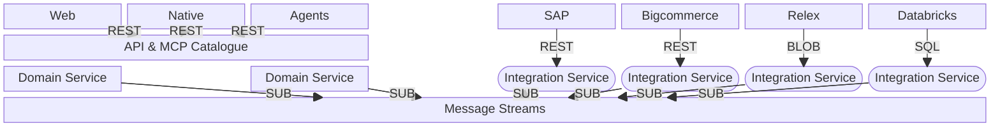

# ● Kalt — Index

This project is a polyrepo containing applications, shared packages, and domain-, integration-, and core-services.

## Apps

### [app.web](https://github.com/k-lt/app.web)
________
## Services
### Domain services:
### → `svc.applications`
Overview of the preferred applications on the website, that are scored against criteria. [**𝚛𝚎𝚊𝚍 𝚖𝚘𝚛𝚎 ↗**](https://github.com/k-lt/svc.applications)

### → `svc.companies`
Overview of all the companies in the system. [**𝚛𝚎𝚊𝚍 𝚖𝚘𝚛𝚎 ↗**](https://github.com/k-lt/svc.companies)

### → [svc.communications](https://github.com/k-lt/svc.communications)
### → [svc.clients](https://github.com/k-lt/svc.clients)
### → [svc.countries](https://github.com/k-lt/svc.countries)
### → [svc.direction](https://github.com/k-lt/svc.direction)
### → [svc.dm](https://github.com/k-lt/svc.dm)
### → [svc.doctrine](https://github.com/k-lt/svc.doctrine)
### → [svc.geo](https://github.com/k-lt/svc.geo)
### → [svc.roadmaps](https://github.com/k-lt/svc.roadmaps)
### → [svc.platform](https://github.com/k-lt/svc.platform)
### → [svc.publications](https://github.com/k-lt/svc.publications)
### → [svc.products](https://github.com/k-lt/svc.products)
### → [svc.search](https://github.com/k-lt/svc.search)
### → [svc.tasks](https://github.com/k-lt/svc.tasks)
### → [svc.workspaces](https://github.com/k-lt/svc.workspaces)
### → [svc.workforce](https://github.com/k-lt/svc.workforce)

### Integration services: 
### → [svc.int-linear](https://github.com/k-lt/svc.int-linear)
Publishes source-aligned events using [@pkg.channels](https://github.com/k-lt/pkg.channels) to a channel. Projects back whatever it should project back.

Read more ↗

### →[svc.int-github](https://github.com/k-lt/svc.int-github)
Publishes source-aligned events using [@pkg.channels](https://github.com/k-lt/pkg.channels) to a channel. Projects back whatever it should project back.

Read more ↗

### → [svc.int-google-workspace](https://github.com/k-lt/svc.int-google-workspace)
Publishes source-aligned events using [@pkg.channels](https://github.com/k-lt/pkg.channels) to a channel. Projects back whatever it should project back.

Read more ↗

### → [svc.int-notion](https://github.com/k-lt/svc.int-notion)
Publishes source-aligned events using [@pkg.channels](https://github.com/k-lt/pkg.channels) to a channel. Projects back whatever it should project back.

Read more ↗

### → [svc.int-salesforce](https://github.com/k-lt/svc.int-salesforce)
Publishes source-aligned events using [@pkg.channels](https://github.com/k-lt/pkg.channels) to a channel. Projects back whatever it should project back.

𝗿𝗲𝗮𝗱 𝗺𝗼𝗿𝗲 ↗
________
### [core.psql](https://github.com/k-lt/core.psql)
### [core.observe](https://github.com/k-lt/core.observe)
### [core.inference](https://github.com/k-lt/core.inference)
### [core.auth](https://github.com/k-lt/core.auth)
### [core.blob](https://github.com/k-lt/core.blob)
### core.channels
All domain and integration services communicate using event carried state transfers [⁰¹](https://github.com/k-lt/index/blob/main/concepts.md#-event-carried-state-transfers) on redis streams through the shared HA. [ʀᴇᴀᴅ ᴍᴏʀᴇ **↗**](https://github.com/k-lt/core.channels)

### [core.gateway](https://github.com/k-lt/core.gateway)
### [core.node](https://github.com/k-lt/core.node)
### [pkg.auth](https://github.com/k-lt/pkg.auth)
### [pkg.psql](https://github.com/k-lt/pkg.psql)
### [pkg.gateway](https://github.com/k-lt/pkg.gateway)
### [pkg.contracts](https://github.com/k-lt/pkg.contracts)
### [pkg.channels](https://github.com/k-lt/pkg.channels)
### [pkg.observe](https://github.com/k-lt/pkg.observe)

⁰¹²³⁴⁵⁶⁷⁸⁹