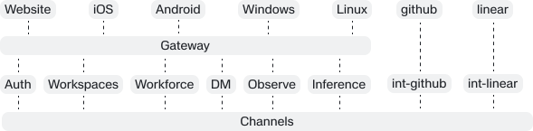

# ● Kalt — Index

This project is a polyrepo containing applications, shared packages, and domain-, integration-, and core-services. Based on the principles from domain driven design, team topologies, and enterprise clean architecture.

<br/> <br/>




<p align="center"> Illustration of architecture with some elements </p>

Around the whole architeture is the nodes and on the nodes we have instances of a blob store (based on garage), databases (based on PSQL) that are not depicted in the image itself.

<br/> <br/>

## Contracts
`pkg.contracts`  – <a href="https://github.com/k-lt/pkg.contracts"></a>

Everything in the platform is fully contract driven, even the source-aligned integrations has contracts they offer over the channels it distributes data on. This repository is editable by the owners of the contracts. The contracts, both for messages and for the API is versioned.

This allows us to introduce breaking changes and have the other services and applications gracefully migrate over to the next version.

This repository is made available as a GitHub Packages, and contain some minor helpers to consume some of the source-aligned events. But they never contain any domain logic or similar. 


```bash
npm install @k-lt/contracts@0.1.0
```

<br/> <br/>

## Bare metal nodes     
`core.node` – <a href="https://github.com/k-lt/core.node"></a>


The bare metal nodes are all running from Hetzner. The `core.node` repository is used to: 
1. Set up new nodes
2. Runs a watcher on the server
3. Ensures new merges to main is reflected on the specific node

And that is about it. It makes it feel like Vercel while running on bare metal. 


<br/> <br/>

## Gateway    
`core.gateway` – <a href="https://github.com/k-lt/core.gateway"></a> – <a href="https://github.com/k-lt/pkg.gw"></a>

The gateway is where all traffic inbound to the node goes through, it is based on Pingora and extended with MCP capabilites. All the domain services makes their APIs available on the gateway using the `@pkg.gw` library. 

That way all services' APIs feel and look the same across the board. It enforces a level of conformity throughout the platform.


<br/><br/>


## Channels   
`core.channels` –  <a href="https://github.com/k-lt/core.channels"></a> – <a href="https://github.com/k-lt/pkg.ch"></a>

Based on redis streams All domain and integration services communicate using event carried state transfers[^1] on redis streams through the shared HA.


The messages are put on channels that are either:
| Source aligned | Domain aligned |
|----------------|---------------|
| We distribute everything always, regardless of volume or if we cannot conceive of the use case yet. This is one of the promises the platform has to all other parts of the ecosystem, we have data distribution of everything, always.<br><br>Raw messages from source systems, all are distributed, no filtering, can be chatty af, no problem. Only action done here is a direct mapping to a system specific model with less cryptic naming conventions (think Astra 4 character column names, think CRM selection value codes). No business logic, just effective data distribution. Dumb and performant.<br><br>Seems raw and chaotic, requires domain and systems level knowledge to consume.<br><br>Upstream events are owned by one domain service, other services should only consume other domain events. Egress integrations can consume raw upstream events, but the drawbacks are very clear. | Anything that is created, deleted or updated triggers an event from the domain service. The events always contain the entire object (event carried state transfers). Each integration and other service needs to be idempotent (using hashsums and timestamps)<br><br>Well structured and idempotency inside the service, easy to consume and understand, requires low to no domain knowledge.<br><br>Even though there is implicit idempotency, all consumers still have to be idempotent themselves. |


Alternative naming could be 

<br/><br/>


## Postgres databases   
`core.psql` –  <a href="https://github.com/k-lt/core.psql"></a> – <a href="https://github.com/k-lt/pkg.psql"></a>

A centrally managed instance of Multigres that support all the services. Since everything is run on multiple nodes, we achieve HA.


<br/><br/>


## Blob storage
`core.blob` –  <a href="https://github.com/k-lt/core.blob"></a> – <a href="https://github.com/k-lt/core.blob"></a>


<br/> <br/>


## [core.observe](https://github.com/k-lt/core.observe)

## Authentication
`core.auth`  –  <a href="https://github.com/k-lt/core.auth"></a> – <a href="https://github.com/k-lt/pkg.auth"></a>

<br/><br/>

## Inference
`core.inference` – [ʀᴇᴀᴅ ᴍᴏʀᴇ ↗](https://github.com/k-lt/core.inference)

We're not building just another inference alternative, but we are hosting our own fine tuned and specialized models, and have a router to other inference providers at 0% fee.


<br/> <br/>

## Applications
`svc.applications`  –  <a href="https://github.com/k-lt/svc.applications"></a>

Overview of the preferred applications on the website, that are scored against a list of criteria. It is an opinionated exclusion driven list. 

<br/><br/>

## Companies
`svc.companies` – <a href="https://github.com/k-lt/svc.companies"></a>

Overview of all the companies in the system.

<br/><br/>

## Communications
`svc.communications` – <a href="https://github.com/k-lt/svc.communications"></a>

<br/><br/>

## Clients
`svc.clients` – <a href="https://github.com/k-lt/svc.clients"></a>

Clients is the 

<br/><br/>

## Countries
`svc.countries` – <a href="https://github.com/k-lt/svc.countries"></a>

Overview of all countries in the world. Available via API, MCP and through domain messages to other services.

## Direction
`svc.direction` – <a href="https://github.com/k-lt/svc.direction"></a>

Here goes the paragraph

<br/><br/>

## DM
 `svc.dm` – <a href="https://github.com/k-lt/svc.dm"></a>

The DM service is a super lightweight and minimal chatting service that support both agents and real humans to talk together in threads, it pull together both external and internal people into the same chat rooms.

<br/><br/>

## Doctrine
`svc.doctrine` – <a href="https://github.com/k-lt/svc.doctrine"></a>

## Geo
`svc.geo` – <a href="https://github.com/k-lt/svc.geo"></a>

### Roadmaps
`svc.roadmaps` – <a href="https://github.com/k-lt/svc.roadmaps"></a>

### Platform
`svc.platform` – <a href="https://github.com/k-lt/svc.platform"></a>

### Publications
`svc.publications` – <a href="https://github.com/k-lt/svc.publications"></a>

### Products
`svc.products` – <a href="https://github.com/k-lt/svc.products"></a>

### Search
`svc.search` – <a href="https://github.com/k-lt/svc.search"></a>

### Tasks
`svc.tasks` – <a href="https://github.com/k-lt/svc.tasks"></a>

### Workspaces
`svc.workspaces` – <a href="https://github.com/k-lt/svc.workspaces"></a>

### Workforce
`svc.workforce` – <a href="https://github.com/k-lt/svc.workforce"></a>

### Integration services:


<details>

<summary>Integration services</summary>


### Linear
`svc.int-linear` – <a href="https://github.com/k-lt/svc.int-linear"></a>

Publishes source-aligned events using [@pkg.channels](https://github.com/k-lt/pkg.channels) to a channel. Projects back whatever it should project back.

### GitHub
`svc.int-github` – <a href="https://github.com/k-lt/svc.int-github"></a>

Publishes source-aligned events using [@pkg.channels](https://github.com/k-lt/pkg.channels) to a channel. Projects back whatever it should project back.

### Google Workspace
`svc.int-google-workspace` – <a href="https://github.com/k-lt/svc.int-google-workspace"></a>

Publishes source-aligned events using [@pkg.channels](https://github.com/k-lt/pkg.channels) to a channel. Projects back whatever it should project back.

### Notion
`svc.int-notion` – <a href="https://github.com/k-lt/svc.int-notion"></a>

Publishes source-aligned events using [@pkg.channels](https://github.com/k-lt/pkg.channels) to a channel. Projects back whatever it should project back.

### Salesforce
`svc.int-salesforce` – <a href="https://github.com/k-lt/svc.int-salesforce"></a>

Publishes source-aligned events using [@pkg.channels](https://github.com/k-lt/pkg.channels) to a channel. Projects back whatever it should project back.


</details>


[^1]:The events enclose all the data for the domain, rather than serving as basic change notifications or a smaller subset of the entity. When a source system modifies data, it broadcasts an event carrying the detailed state, enabling downstream consumer systems to replicate and maintain local copies of the information.  With all required data locally accessible, consumer services can execute processing and queries directly without making remote network calls back to the originating service, which reduces network traffic while improving performance, availability, and system decoupling.