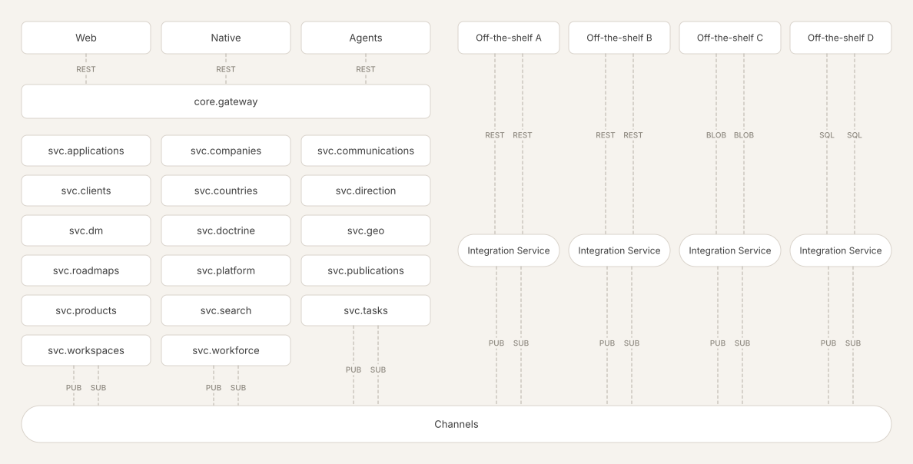

# ● Kalt — Index

This project is a polyrepo containing applications, shared packages, and domain-, integration-, and core-services.

## Apps

### [app.web](https://github.com/k-lt/app.web)
________
## Services
### Domain services:
### Applications
`svc.applications` – 

Overview of the preferred applications on the website, that are scored against criteria.

### Companies
`svc.companies` – 

Overview of all the companies in the system.

### Communications
`svc.communications` – 

### Clients
`svc.clients` – 

Clients is the .

### Countries
`svc.countries` – 

Overview of all countries in the world. Available via API, MCP and through domain messages to other services.

### Direction
`svc.direction` – 

### DM
#### `svc.dm` – 

The DM service is a super lightweight and minimal chatting service that support both agents and real humans to talk together in threads, it pull together both external and internal people into the same chat rooms.

### Doctrine
`svc.doctrine` – 

### Geo
`svc.geo` – 

### Roadmaps
`svc.roadmaps` – 

### Platform
`svc.platform` – 

### Publications
`svc.publications` – 

### Products
`svc.products` – 

### Search
`svc.search` – 

### Tasks
`svc.tasks` – 

### Workspaces
`svc.workspaces` – 

### Workforce
`svc.workforce` – 

### Integration services:
### Linear
`svc.int-linear` – 

Publishes source-aligned events using [@pkg.channels](https://github.com/k-lt/pkg.channels) to a channel. Projects back whatever it should project back.

### GitHub
`svc.int-github` – 

Publishes source-aligned events using [@pkg.channels](https://github.com/k-lt/pkg.channels) to a channel. Projects back whatever it should project back.

### Google Workspace
`svc.int-google-workspace` – 

Publishes source-aligned events using [@pkg.channels](https://github.com/k-lt/pkg.channels) to a channel. Projects back whatever it should project back.

### Notion
`svc.int-notion` – 

Publishes source-aligned events using [@pkg.channels](https://github.com/k-lt/pkg.channels) to a channel. Projects back whatever it should project back.

### Salesforce
`svc.int-salesforce` – 

Publishes source-aligned events using [@pkg.channels](https://github.com/k-lt/pkg.channels) to a channel. Projects back whatever it should project back.

________
### [core.psql](https://github.com/k-lt/core.psql)
### [core.observe](https://github.com/k-lt/core.observe)
### core.auth
[ʀᴇᴀᴅ ᴍᴏʀᴇ ↗](https://github.com/k-lt/core.auth)
### core.blob
[ʀᴇᴀᴅ ᴍᴏʀᴇ ↗](https://github.com/k-lt/core.blob)
### core.channels
All domain and integration services communicate using event carried state transfers [⁰¹](https://github.com/k-lt/index/blob/main/concepts.md#-event-carried-state-transfers) on redis streams through the shared HA. [ʀᴇᴀᴅ ᴍᴏʀᴇ ↗](https://github.com/k-lt/core.channels)

### core.gateway
[ʀᴇᴀᴅ ᴍᴏʀᴇ ↗](https://github.com/k-lt/core.gateway)
### core.node
[ʀᴇᴀᴅ ᴍᴏʀᴇ ↗](https://github.com/k-lt/core.node)

### core.inference
[ʀᴇᴀᴅ ᴍᴏʀᴇ ↗](https://github.com/k-lt/core.inference)
### [pkg.auth](https://github.com/k-lt/pkg.auth)
### [pkg.psql](https://github.com/k-lt/pkg.psql)
### [pkg.gateway](https://github.com/k-lt/pkg.gateway)
### [pkg.contracts](https://github.com/k-lt/pkg.contracts)
### [pkg.channels](https://github.com/k-lt/pkg.channels)
### [pkg.observe](https://github.com/k-lt/pkg.observe)

⁰¹²³⁴⁵⁶⁷⁸⁹